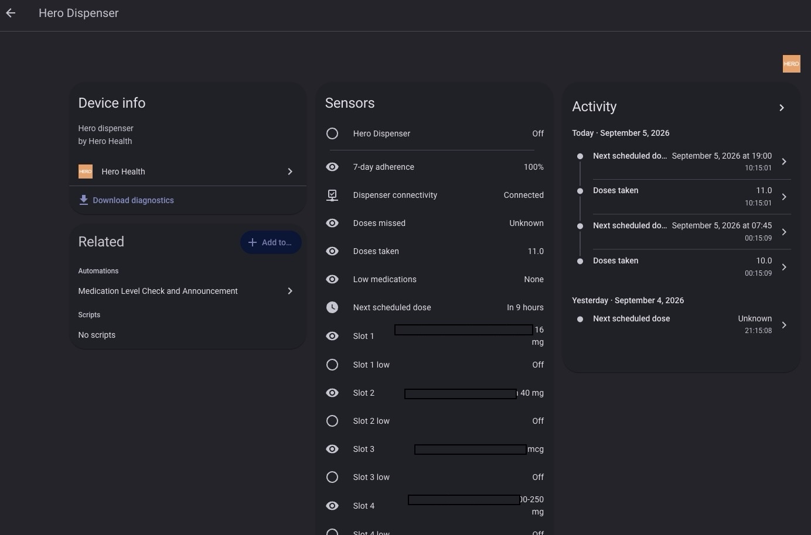

# Hero Health for Home Assistant


See your Hero medication dispenser's status, scheduled doses, and medication information in Home Assistant.

[](https://github.com/andrewtryder/ha-herohealth/releases/latest)
[](https://github.com/andrewtryder/ha-herohealth/actions/workflows/validate.yml)
[](LICENSE)
[](https://my.home-assistant.io/redirect/hacs_repository/?owner=andrewtryder&repository=ha-herohealth&category=integration)



> [!WARNING]
> This integration can initiate a physical medication dispense through its safety-gated controls. Do not rely on an automation as a substitute for medical advice, checking the dispenser, or confirming the correct medication and dose. Review [Safety & Remote Dispensing](#safety--remote-dispensing) before using those controls.

## What can I do with it?

Monitor dispenser connectivity, upcoming and recent doses, missed doses, seven-day adherence, low-medication warnings, and information about medication slots. Use the sensors in dashboards or the [automation examples](docs/AUTOMATIONS.md). A separate, safety-gated button and administrator action can request a scheduled physical dispense; monitoring does not require using them.

## Requirements and compatibility

- Home Assistant **2026.8.3 or newer**, HACS (or the built-in Home Assistant Marketplace in **2026.11+**), a Hero medication dispenser, and a Hero account.
- Some information depends on what Hero currently reports. When a live next-dose window has no future dose, the integration may use the recurring weekly schedule to show the next scheduled time.

## Install with HACS or Home Assistant Marketplace

[](https://my.home-assistant.io/redirect/hacs_repository/?owner=andrewtryder&repository=ha-herohealth&category=integration)

1. Click the **Open your Home Assistant instance** button above (backwards compatible: opens **HACS** on earlier versions and the built-in **Home Assistant Marketplace** on **2026.11+**), or manually add `https://github.com/andrewtryder/ha-herohealth` as a custom repository in the **Integration** category.
2. Find and install **Hero Health**.
3. Restart Home Assistant.

## First-time setup

1. Go to **Settings → Devices & services → Add integration** and select **Hero Health**.
2. Sign in with your Hero account and finish setup.
3. Your dispenser and available entities appear in Home Assistant.

## What you'll see in Home Assistant

Available entities can include the next scheduled dose, doses taken and missed, recent dose activity, seven-day adherence, low-medication counts, individual medication slots, and dispenser connectivity. The dispense-availability sensor and scheduled-dose button are separate from monitoring entities. Entity availability depends on the dispenser and account data.

## Common problems and troubleshooting

- If the dispenser appears unavailable or information is missing, check its connectivity and the Hero app, then review the integration in **Settings → Devices & services**.
- Some information may not be present in Hero's current data. Do not infer that a medication was taken solely from a missing or stale entity.
- For reproducible problems, open a [GitHub issue](https://github.com/andrewtryder/ha-herohealth/issues). Do not include credentials or private health information.

## Important limitations, safety, and privacy

## Safety & Remote Dispensing

The integration includes a safety-gated button entity (`button.hero_health_dispense_scheduled_dose`) and an administrative action (`hero_health.dispense_scheduled_dose`):

- **Strict Eligibility Window**: A dose can only be dispensed when Hero marks it ready (`time_to_take`) and the current time is starting 30 minutes before its scheduled time up to 6 hours after, matching Hero's physical dispenser rules.
- **Admin-Gated Execution**: Remote dispensing is restricted to Home Assistant administrators and always performs a fresh state check before dispensing.
- **Durable Idempotency Journal**: Dispenses are recorded in durable storage to prevent duplicate dispenses across restarts and reloads.
- **Fail-Closed Ambiguity Handling**: If communication drops after a dispense start frame has been sent, the dose state is flagged as unknown and subsequent remote dispenses for that time are blocked until dispenser state is physically verified.
- **Boundary Timers & Authoritative Refresh**: Availability sensors and buttons schedule local timers at window open/close boundaries and request a targeted Hero refresh at the scheduled dose time rather than relying on continuous cloud polling.

---

## Privacy & Database Storage

Home Assistant's recorder stores entity state changes over time. To protect sensitive medication information and keep your database performant:

- Detailed medication attributes (such as pill types, exact counts, and schedule details) are marked unrecorded (`_unrecorded_attributes`), excluding them from Recorder history attributes.
- Individual slot sensors (`sensor.hero_health_slot_<n>`) expose the current medication name (or "Empty") as their entity state for dashboard visibility. Home Assistant Recorder may store these state strings in database history and backups.
- Users who wish to keep medication names out of database history entirely can disable individual slot sensor entities in Home Assistant, or exclude them from database history in `configuration.yaml` via Recorder settings:
  ```yaml
  recorder:
    exclude:
      entity_globs:
        - sensor.hero_health_slot_*
  ```
- Diagnostic downloads export only boolean and numeric operational metadata, omitting credentials, tokens, account identifiers, and private health data.

## More documentation

- [Automation examples](docs/AUTOMATIONS.md)
- [Migration from the earlier project](MIGRATION.md)
- [Contributing and development](CONTRIBUTING.md) and [porting notes](docs/porting-notes.md)

## Support and license

To remove the integration, go to **Settings → Devices & services → Hero Health**, open its menu, and select **Delete**. This removes local session stores, cached tokens, and entities.

This community project is independent and unofficial; it is not affiliated with or endorsed by Hero Health. Hero and Hero Health belong to their respective owner. See the [license](LICENSE).
